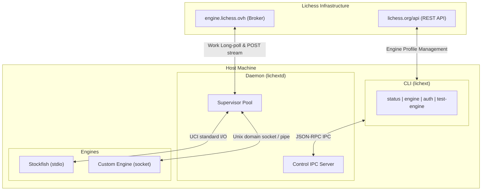

# Chexperts - Lichexternal

Connect any local or remote chess engine directly to your Lichess analysis board.

Lichexternal bridges the [Lichess External Engine API](https://lichess.org/api/external-engine) with your hardware. Run Stockfish, Maia, Leela Chess Zero, or custom engines locally without browser performance limits, keeping your credentials secure and your evaluation responsive.

## Features

- **Generic Engine Support**: Works with standard UCI executables through subprocess pipes (`stdio`) or persistent socket daemons (`socket`).
- **Interactive Authentication**: Log in directly from your terminal using OAuth 2.0 PKCE. No manual token creation or file editing required.
- **Responsive Streaming**: Streams engine calculations in real time. Stops evaluation immediately when you change moves or close the browser tab.
- **Cross-Platform**: Runs on Linux, macOS, and Windows. The core protocol crate compiles to `wasm32-unknown-unknown` for web contexts.
- **System Integration**: Packaged with ready-to-use NixOS and Home Manager service modules.

## Quick Start

### 1. Authenticate with Lichess

Log in using OAuth directly from the terminal:

```bash
lichext auth login
```

This opens your browser to authorize `chexperts-lichexternal` (`engine:read engine:write`) and saves the credentials securely to your configuration directory.

To check login status at any time:

```bash
lichext auth status
```

For headless servers or automated environments, pass a personal token instead:

```bash
export LICHESS_API_TOKEN="lip_your_personal_token"
```

### 2. Register an Engine on Lichess

Register your engine profile with Lichess:

```bash
lichext engine register \
  --name "Stockfish 19" \
  --max-threads 16 \
  --max-hash 4096 \
  --variants chess,atomic
```

This returns an engine `id` and `provider_secret`.

### 3. Configure the Daemon

The daemon loads configuration from standard OS directories:
- Linux: `~/.config/lichexternal/config.toml`
- macOS: `~/Library/Application Support/lichexternal/config.toml`
- Windows: `%LOCALAPPDATA%\lichexternal\config.toml`

If missing, the daemon automatically creates a documented template on its first run. You can also view all configuration options in [config.example.toml](../config.example.toml).

Example configuration:

```toml
log_level = "info"
broker_base_url = "https://engine.lichess.ovh"

# Subprocess engine via standard I/O
[[engines]]
id = "YOUR_ENGINE_ID"
provider_secret = "YOUR_PROVIDER_SECRET"
name = "Stockfish 19"
type = "stdio"
command = "/usr/bin/stockfish"
max_threads = 16
max_hash = 4096
variants = ["chess", "atomic"]

# Persistent engine via local socket
[[engines]]
id = "YOUR_SOCKET_ENGINE_ID"
provider_secret = "YOUR_SOCKET_PROVIDER_SECRET"
name = "Chexpectimax"
type = "socket"
socket = "/run/user/1000/chexpectimax.sock"
max_threads = 8
max_hash = 2048
variants = ["chess"]
```

Before running, test that your engine binary communicates correctly using UCI:

```bash
lichext test-engine /usr/bin/stockfish
```

### 4. Run the Daemon

Start the background service:

```bash
lichextd
```

### 5. Check Live Status

Check the status of running engines from another terminal:

```bash
lichext status
```

Output:

```text
Lichexternal Daemon v0.1.0

╭───┬────────────────────┬──────────────┬─────────┬───────────┬────────────────┬───────╮
│ # │ ID                 │ Name         │ Backend │ Status    │ Active Work    │ Depth │
├───┼────────────────────┼──────────────┼─────────┼───────────┼────────────────┼───────┤
│ 0 │ stockfish-local    │ Stockfish 19 │ stdio   │ analyzing │ work-abc-12345 │ 24    │
│ 1 │ chexpectimax-local │ Chexpectimax │ socket  │ idle      │ -              │ -     │
╰───┴────────────────────┴──────────────┴─────────┴───────────┴────────────────┴───────╯
```

For scripts and pipeline automation, get machine-readable output:

```bash
lichext status --json
```

## Nix Integration

### Running via Flake

```bash
# Run CLI
nix run .#lichext -- status

# Run daemon
nix run .#lichextd
```

### NixOS Module

```nix
{
  services.lichexternald = {
    enable = true;
    settings = {
      log_level = "info";
      engines = [
        {
          id = "stockfish-local";
          provider_secret = "secret-xyz";
          name = "Stockfish";
          type = "stdio";
          command = lib.getExe pkgs.stockfish;
          max_threads = 8;
          max_hash = 2048;
          variants = [ "chess" ];
        }
      ];
    };
  };
}
```

### Home Manager Module

```nix
{
  services.lichexternald = {
    enable = true;
    settings = {
      engines = [ ... ];
    };
  };
}
```

## Architecture

### Components

| Name | Description | Supported Targets |
| - | - | - |
| [**`lichext`**](../crates/lichexternal-cli) | Command-line management tool for authentication, engine registration, and live inspection. | Linux, macOS, Windows |
| [**`lichextd`**](../crates/lichexternal-daemon) | Background daemon managing engine processes, polling work from Lichess, and streaming evaluations. | Linux, macOS, Windows, Android |
| [**`lichexternal-core`**](../crates/lichexternal-core) | Protocol definitions, UCI command serialization, SIMD stream parsing, and configuration models. | Linux, macOS, Windows, Android, `wasm32-unknown-unknown` |

### Diagram



## Authentication

Lichexternal separates account credentials from work execution:

1. **Profile Management**: Handled via the Lichess [REST API](https://lichess.org/api/external-engine) using your OAuth token or personal access token.
2. **Work Execution**: Handled via the [Broker Work API](https://engine.lichess.ovh/api/external-engine/work) using only the engine's `provider_secret`.
3. **Isolation**: You can run `lichextd` on untrusted machines or remote servers with only the individual engine's `provider_secret`. Your Lichess account credentials never need to leave your primary machine.
